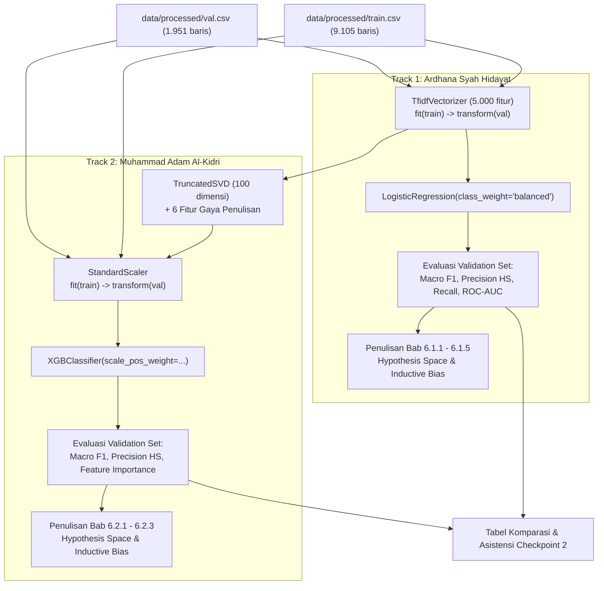

# RENCANA IMPLEMENTASI MINGGU 3: [M] MODEL DESIGN (BASELINE & ADVANCED)

**Mata Kuliah:** Data Science (Semester 5)  
**Proyek:** Analisis Klasifikasi Ujaran Kebencian pada Informasi Pemerintahan Indonesia di Media Sosial Menggunakan Machine Learning dan Deep Learning  
**Keterkaitan SDG:** **SDG 16** (*Peace, Justice and Strong Institutions*) — Target 16.10 & 16.7  
**Tim Pengusul:**
1. **Ardhana Syah Hidayat (244311037)** — Anggota 1 (Lead Baseline Model & Framing Komparasi)
2. **Muhammad Adam Al-Kidri (244311050)** — Anggota 2 (Lead Advanced Model & Feature Fusion)

---

## 1. Ringkasan Eksekutif & Sasaran Modul
Modul Minggu 3 bertujuan merancang, melatih, mengevaluasi, dan mendokumentasikan dua model pertama (*Baseline* dan *Advanced*) berdasarkan teori ruang hipotesis (*hypothesis space*) dan asumsi induktif (*inductive bias*). 

> [!IMPORTANT]
> **Protokol Integritas Data:** Seluruh pelatihan dilakukan pada `data/processed/train.csv` (9.105 baris) dan evaluasi performa **HANYA menggunakan `data/processed/val.csv` (1.951 baris)**. File `data/processed/test.csv` (1.952 baris) **TETAP DISEGEL** dan tidak disentuh sampai evaluasi akhir di Minggu 6.

---

## 2. Matriks Pembagian Tugas (*Responsibility Assignment Matrix*)

| Komponen Deliverable | Anggota Penanggung Jawab (*Lead*) | Rekan Kolaborator (*Reviewer*) | Artefak Luaran |
| :--- | :--- | :--- | :--- |
| **Model 1 (Baseline ML)** | **Ardhana Syah Hidayat (244311037)** | Muhammad Adam Al-Kidri | `notebooks/03_model_design_baseline_ml.ipynb` |
| **Bab 6.1 (Laporan Baseline)** | **Ardhana Syah Hidayat (244311037)** | Muhammad Adam Al-Kidri | `docs/bab6-model-design.md` (Bagian 6.1.1–6.1.5) |
| **Model 2 (Advanced ML)** | **Muhammad Adam Al-Kidri (244311050)** | Ardhana Syah Hidayat | `notebooks/03_model_design_advanced_ml.ipynb` |
| **Bab 6.2 (Laporan Advanced)** | **Muhammad Adam Al-Kidri (244311050)** | Ardhana Syah Hidayat | `docs/bab6-model-design.md` (Bagian 6.2.1–6.2.3) |
| **Sintesis Komparasi & Audit** | **Ardhana & Muhammad Adam (Bersama)** | Dosen Pengampu / Asisten | Tabel Komparasi Validasi & Form Asistensi |

---

## 3. Rincian Teknis per Anggota



---

### Track 1: Anggota 1 — Ardhana Syah Hidayat
**Tugas Utama:** Membangun fondasi pemodelan linier berbasis frekuensi leksikal (*linear lexical benchmark*).

#### 1. Implementasi Notebook (`03_model_design_baseline_ml.ipynb`)
1. **Pemuatan Data:**
   * Membaca `data/processed/train.csv` dan `val.csv` menggunakan `keep_default_na=False` atau `.fillna('')`.
2. **Transformasi Fitur:**
   * Input teks: `text_clean_lexical`.
   * Model representasi: `TfidfVectorizer(max_features=5000, min_df=2, ngram_range=(1,2), sublinear_tf=True)`.
   * **Aturan Anti-Leakage:** `.fit(train['text_clean_lexical'])`, lalu `.transform()` ke data latih dan validasi.
3. **Pelatihan Model:**
   * Inisialisasi: `LogisticRegression(class_weight='balanced', solver='lbfgs', max_iter=1000, random_state=42)`.
   * Pencatatan nilai regularisasi awal ($C = 1.0$).
4. **Evaluasi Validasi:**
   * Prediksi probabilitas dan kelas pada `val.csv`.
   * Metrik wajib: **Macro F1-Score**, **Precision Kelas 1 (*Hate Speech*)**, **Recall Kelas 1**, **ROC-AUC**, dan **PR-AUC**.
   * Visualisasi: *Confusion Matrix* dan Analisis 20 Koefisien Terbesar (kata pemicu `HS=1` vs `HS=0`).

#### 2. Penulisan Laporan Bab 6.1 (di `docs/bab6-model-design.md`)
* **Bab 6.1.1 (Teori Dasar & Alasan Pemilihan):**
  * Menjelaskan mengapa Logistic Regression tepat untuk matriks teks berdimensi tinggi ($D=5.000$) yang *sparse*.
  * Menguraikan fungsi loss *Binary Cross-Entropy* dengan penalti $L_2$ Ridge dan sifat optimasi konveksnya.
* **Bab 6.1.2 (Hypothesis Space & Inductive Bias):**
  * Menuliskan formulasi matematis ruang hipotesis linear:
    $$\mathcal{H} = \left\{ f(\mathbf{x}) = \sigma(\mathbf{w}^T \mathbf{x} + b) \mid \mathbf{w} \in \mathbb{R}^{5000}, b \in \mathbb{R} \right\}$$
  * Membahas 3 asumsi induktif: *Linear Separability of log-odds*, *Feature Additivity* (independensi kontribusi kata), dan *Gaussian Prior on Weights* (penalti $L_2$).
* **Bab 6.1.3–6.1.5 (Pencatatan Parameter & Hasil):**
  * Dokumentasi tabel hiperparameter awal.
  * Hasil metrik pada Validation Set beserta interpretasi linguistik dari koefisien kata teratas.

---

### Track 2: Anggota 2 — Muhammad Adam Al-Kidri
**Tugas Utama:** Membangun model non-linear berbasis ansambel pohon dengan memadukan informasi semantik tereduksi dan fitur gaya penulisan (*feature fusion*).

#### 1. Implementasi Notebook (`03_model_design_advanced_ml.ipynb`)
1. **Pemuatan Data & Ekstraksi Fitur:**
   * Menggunakan representasi TF-IDF yang telah di-fit oleh Track 1 (atau pipeline yang sama).
   * Mereduksi matriks TF-IDF menjadi 100 fitur kontinu menggunakan `TruncatedSVD(n_components=100, random_state=42)`.
   * Menyiapkan 6 fitur gaya penulisan numerik: `char_length`, `word_count`, `caps_ratio`, `exclamation_count`, `user_mention_count`, `abusive_lexicon_count`.
2. **Penggabungan & Standarisasi (*Feature Concatenation*):**
   * Menggabungkan 100 komponen SVD + 6 fitur numerik $\rightarrow$ 106 fitur padat (*dense*).
   * Standarisasi via `StandardScaler()`: di-`.fit()` hanya pada data latih, lalu `.transform()` pada data validasi.
3. **Pelatihan Model:**
   * Inisialisasi: `XGBClassifier(n_estimators=100, max_depth=6, learning_rate=0.1, scale_pos_weight=..., eval_metric='logloss', random_state=42)`.
4. **Evaluasi Validasi:**
   * Pencatatan metrik di `val.csv`: Macro F1, Precision Kelas 1, Recall Kelas 1, dan ROC-AUC.
   * Visualisasi: *Confusion Matrix* dan *Feature Importance* (menganalisis apakah fitur gaya penulisan masuk dalam 15 fitur paling berpengaruh).

#### 2. Penulisan Laporan Bab 6.2 (di `docs/bab6-model-design.md`)
* **Bab 6.2.1 (Teori Dasar, Keunggulan & Kelemahan):**
  * Menjelaskan prinsip *Gradient Tree Boosting* (ansambel aditif pohon regresi bertingkat).
  * Menjelaskan mengapa TruncatedSVD diperlukan sebelum masuk ke pohon keputusan (menghindari lambatnya *split* pada 5.000 fitur *sparse*).
  * Analisis keunggulan (menangkap interaksi non-linear) dan kelemahan (waktu latih & risiko overfitting).
* **Bab 6.2.2 (Hypothesis Space & Inductive Bias):**
  * Menuliskan ruang hipotesis pohon keputusan aditif:
    $$\mathcal{H} = \left\{ f(\mathbf{x}) = \sum_{k=1}^K f_k(\mathbf{x}) \mid f_k \in \mathcal{F} \right\}$$
  * Membahas 3 asumsi induktif: *Axis-Aligned Partitioning*, *Hierarchical Feature Interaction*, dan *Regularization via Shrinkage & Tree Depth Constraint*.
* **Bab 6.2.3 (Pencatatan Parameter & Hasil):**
  * Dokumentasi tabel hiperparameter awal.
  * Hasil metrik pada Validation Set dan analisis fitur gaya penulisan yang dominan.

---

## 4. Kerangka Kerja Bersama: Sintesis & Komparasi

Setelah kedua notebook berhasil dijalankan, kedua anggota menyusun sub-bab perbandingan bersama pada berkas `docs/bab6-model-design.md`:

### Tabel Komparasi Validasi yang Wajib Dicapai

| Metrik Evaluasi | Model 1: Baseline (Logistic Regression) | Model 2: Advanced (XGBoost + SVD + Fitur Gaya) | Selisih ($\Delta$) | Analisis Keunggulan |
| :--- | :---: | :---: | :---: | :--- |
| **Macro F1-Score** | *[Diisi dari Val]* | *[Diisi dari Val]* | ... | Mengukur keseimbangan performa |
| **Precision (Kelas 1 - HS)** | *[Diisi dari Val]* | *[Diisi dari Val]* | ... | Mencegah False Positive (Sensor Kritik) |
| **Recall (Kelas 1 - HS)** | *[Diisi dari Val]* | *[Diisi dari Val]* | ... | Menangkap ujaran kebencian aktual |
| **ROC-AUC** | *[Diisi dari Val]* | *[Diisi dari Val]* | ... | Pemisahan probabilitas kelas |
| **Waktu Pelatihan (Detik)** | *[Diisi dari Val]* | *[Diisi dari Val]* | ... | Efisiensi komputasi |

---

## 5. Timeline Eksekusi Kerja (3 Sesi Kerja)

```text
Sesi 1: Penyiapan Pipeline & Baseline (Est. 2-3 jam)
├── Anggota 1: Implementasi dan run `03_model_design_baseline_ml.ipynb`
├── Anggota 2: Review TF-IDF pipeline & verifikasi bebas leakage pada val set
└── Output Sesi 1: Metrik Baseline Validation Set tercatat & Bab 6.1 selesai

Sesi 2: Implementasi Advanced Model (Est. 2-3 jam)
├── Anggota 2: Implementasi TruncatedSVD + Feature Concatenation + XGBoost
├── Anggota 1: Validasi pipeline scaling & cross-check metrik validasi XGBoost
└── Output Sesi 2: Metrik XGBoost Validation Set tercatat & Bab 6.2 selesai

Sesi 3: Finalisasi Laporan & Asistensi Checkpoint 2 (Est. 1-2 jam)
├── Bersama: Mengisi tabel komparasi di `docs/bab6-model-design.md`
├── Bersama: Verifikasi checklist modul Minggu 3
└── Bersama: Commit notebook & push ke GitHub untuk asistensi
```

---

## 6. Checklist Verifikasi Akhir Sebelum Asistensi Dosen

- [ ] **Data Integrity:** Tidak ada satupun pemanggilan file `data/processed/test.csv` di kedua notebook.
- [ ] **Bebas Data Leakage:** Seluruh transformasi (`TfidfVectorizer`, `TruncatedSVD`, `StandardScaler`) hanya menggunakan `.fit()` pada data latih, dan `.transform()` pada data validasi.
- [ ] **Karakteristik Data Disebutkan:** Alasan pemilihan model mengaitkan sparse/high-dimensional matrix (LogReg) dan interaksi non-linear fitur gaya penulisan (XGBoost).
- [ ] **Inductive Bias & Hypothesis Space Lengkap:** Rumus $\mathcal{H}$ dan asumsi apriori tercantum eksplisit di Bab 6.1 dan 6.2.
- [ ] **Git Tracking:** Notebook `03_model_design_baseline_ml.ipynb`, `03_model_design_advanced_ml.ipynb`, dan berkas `docs/bab6-model-design.md` ter-commit rapi.
