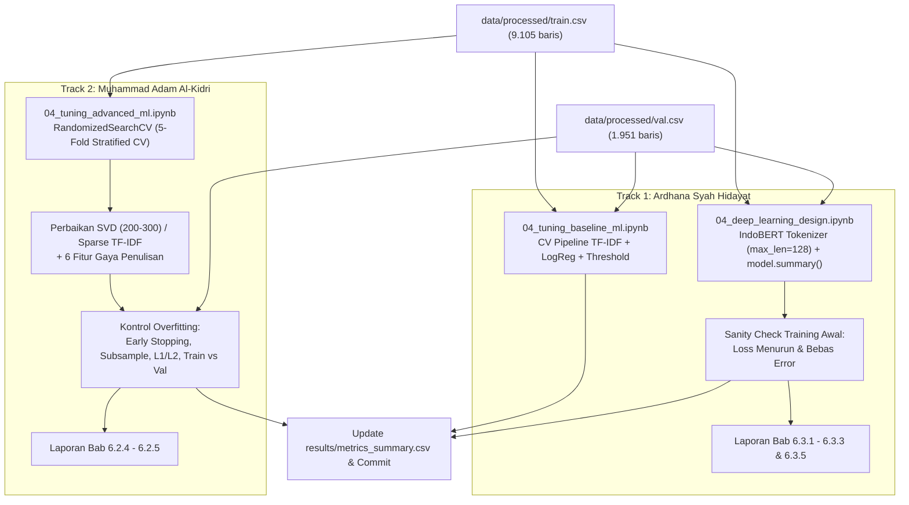

# RENCANA IMPLEMENTASI MINGGU 13: [M → O] TUNING ADVANCED & DESAIN DEEP LEARNING

**Mata Kuliah:** Data Science (Semester 5)  
**Proyek:** Analisis Klasifikasi Ujaran Kebencian pada Informasi Pemerintahan Indonesia di Media Sosial Menggunakan Machine Learning dan Deep Learning  
**Keterkaitan SDG:** **SDG 16** (*Peace, Justice and Strong Institutions*) — Target 16.10 & 16.7  
**Tim Pengusul:**
1. **Ardhana Syah Hidayat (244311037)** — Anggota 1 (Lead Tuning Baseline & Desain Deep Learning)
2. **Muhammad Adam Al-Kidri (244311050)** — Anggota 2 (Lead Tuning Advanced XGBoost & Kontrol Overfitting)

---

## 1. Ringkasan Eksekutif & Sasaran Modul
Modul Minggu 13 memiliki dua sasaran utama:
1. **Optimasi Model ML Klasik (Tahap *Optimization*):** Meningkatkan performa model Baseline dan Advanced melalui *hyperparameter tuning* berbasis *Cross-Validation* serta menerapkan kontrol *overfitting* yang ketat—terutama untuk mengatasi ketertinggalan skor awal XGBoost (`82,22%`) terhadap Baseline (`84,14%`).
2. **Desain & Uji Jalan Deep Learning (Model 3 — IndoBERT):** Merancang arsitektur Transfer Learning (`indobenchmark/indobert-base-p1`), menyiapkan *preprocessing* tokenisasi khusus Transformer, mendokumentasikan jumlah parameter (`model.summary()`), dan menjalankan *sanity check* training awal untuk memastikan *loss* menurun tanpa *error*.

> [!IMPORTANT]
> **Protokol Integritas Data & Hardware:**
> 1. **Test Set Tetap Disegel:** Seluruh *Grid/Random Search* hanya menggunakan *Stratified Cross-Validation* pada `data/processed/train.csv` (9.105 baris) dan evaluasi pada `data/processed/val.csv` (1.951 baris). File `test.csv` **DILARANG** disentuh.
> 2. **Strategi Komputasi CPU vs GPU:** Perangkat lokal menggunakan PyTorch CPU (`CUDA = False`). Tuning scikit-learn/XGBoost dapat dijalankan langsung di CPU lokal, sedangkan *sanity check* IndoBERT di lokal dijalankan pada *mini-subset* (1 epoch, mis. 500–1.000 sampel) atau via **Google Colab (GPU T4)** untuk eksekusi penuh.

---

## 2. Matriks Pembagian Tugas (*Responsibility Assignment Matrix*)

| Komponen Deliverable | Anggota Penanggung Jawab (*Lead*) | Rekan Kolaborator (*Reviewer*) | Artefak Luaran |
| :--- | :--- | :--- | :--- |
| **Tuning Model 1 (Baseline ML)** | **Ardhana Syah Hidayat (244311037)** | Muhammad Adam Al-Kidri | `notebooks/04_tuning_baseline_ml.ipynb` |
| **Desain & Sanity Check DL (Model 3)** | **Ardhana Syah Hidayat (244311037)** | Muhammad Adam Al-Kidri | `notebooks/04_deep_learning_design.ipynb` |
| **Bab 6.3.1–6.3.3 & 6.3.5 (Laporan DL)** | **Ardhana Syah Hidayat (244311037)** | Muhammad Adam Al-Kidri | `docs/bab6-model-design.md` (Bagian 6.3) |
| **Tuning Model 2 (Advanced XGBoost)** | **Muhammad Adam Al-Kidri (244311050)** | Ardhana Syah Hidayat | `notebooks/04_tuning_advanced_ml.ipynb` |
| **Bab 6.2.4–6.2.5 (Tuning & Overfitting)** | **Muhammad Adam Al-Kidri (244311050)** | Ardhana Syah Hidayat | `docs/bab6-model-design.md` (Bagian 6.2.4–6.2.5) |
| **Verifikasi Akhir & Sinkronisasi Metrik** | **Ardhana & Muhammad Adam (Bersama)** | Dosen Pengampu / Asisten | `results/metrics_summary.csv` & Checklist |

---

## 3. Alur Kerja Teknis per Anggota



---

### Track 1: Anggota 1 — Ardhana Syah Hidayat (244311037)
**Fokus:** Optimasi cepat pada *Baseline* dan pembangunan fondasi arsitektur *Deep Learning* (IndoBERT).

#### A. Tuning Baseline (`notebooks/04_tuning_baseline_ml.ipynb`)
1. **Pipeline Search Space (5-Fold Stratified CV pada `train.csv`):**
   * `tfidf__ngram_range`: `[(1, 1), (1, 2)]`
   * `tfidf__max_features`: `[5000, 10000, 15000]`
   * `tfidf__min_df`: `[2, 3, 5]`
   * `clf__C`: `[0.1, 0.5, 1.0, 2.0, 5.0]`
   * `clf__class_weight`: `['balanced', None]`
2. **Optimasi Decision Threshold (pada `val.csv`):**
   * Menguji ambang batas probabilitas $\tau \in [0.30, 0.70]$ untuk mencari titik optimal antara **Macro F1-Score** dan **Precision Kelas 1** ($\ge 85\%$).
3. **Output:** Tabel perbandingan Baseline sebelum vs sesudah tuning dan penyimpanan metrik ke `results/baseline_tuned_val_metrics.json`.

#### B. Desain & Sanity Check Deep Learning (`notebooks/04_deep_learning_design.ipynb`)
1. **Bab 6.3.1 (Pemilihan Jenis DL):**
   * Memilih **Transfer Learning — IndoBERT** (`indobenchmark/indobert-base-p1`).
   * Alasan: Mampu menangkap konteks dua arah (*bidirectional context*), negasi, dan sarkasme politik bahasa Indonesia yang gagal ditangkap oleh model berbasis frekuensi kata (TF-IDF).
2. **Bab 6.3.2 (Arsitektur, Inductive Bias & `model.summary()`):**
   * Menjelaskan struktur 12 layer *Transformer Encoder*, 12 *attention heads*, `hidden_size=768`, dan *classification head* linier (`768 -> 2`).
   * Menjelaskan **Inductive Bias**: *Self-Attention* (ketergantungan jarak jauh antar kata), *Positional Encoding* (urutan kata bermakna), dan *Pre-trained Indonesian Language Prior*.
   * Menampilkan ringkasan parameter eksplisit (`total parameters` ±124,4 juta dan `trainable parameters` per komponen layer) sebagai padanan `model.summary()` di PyTorch.
3. **Bab 6.3.3 (Preprocessing Khusus DL):**
   * Input menggunakan kolom **`text_clean_contextual`** (kata negasi utuh).
   * Tokenisasi via `AutoTokenizer.from_pretrained('indobenchmark/indobert-base-p1')` dengan `max_length=128`, `padding='max_length'`, `truncation=True` $\rightarrow$ menghasilkan tensor `input_ids` dan `attention_mask` berdimensi `(batch_size, 128)`.
4. **Bab 6.3.5 (Training Awal / *Sanity Check*):**
   * Optimizer `AdamW(lr=2e-5, weight_decay=0.01)` dan `CrossEntropyLoss`.
   * Menjalankan **sanity check** (misal: 1–2 epoch pada subset 500–1.000 sampel di CPU, atau *full train* di Google Colab T4) dan memplot kurva **training loss per step/epoch** untuk membuktikan *loss* konsisten menurun dan tidak ada *runtime error*.

---

### Track 2: Anggota 2 — Muhammad Adam Al-Kidri (244311050)
**Fokus:** Mengatasi *information bottleneck* pada XGBoost, melakukan pencarian hiperparameter sistematis, dan mendokumentasikan kontrol *overfitting*.

#### A. Tuning Advanced XGBoost (`notebooks/04_tuning_advanced_ml.ipynb`)
1. **Perbaikan Representasi Fitur (Mengatasi Kelemahan Minggu 3):**
   * Menguji dua skenario fitur:
     * **Skenario A:** Meningkatkan komponen `TruncatedSVD` (mis. `n_components` = `200` atau `300`) + 6 fitur gaya penulisan.
     * **Skenario B:** Menggabungkan langsung TF-IDF *sparse* (`scipy.sparse.hstack`) + 6 fitur gaya penulisan ternormalisasi agar tidak ada informasi leksikal yang terbuang.
   * Memilih representasi terbaik berdasarkan skor validasi.
2. **Hyperparameter Tuning (`RandomizedSearchCV` dengan 5-Fold Stratified CV):**
   * Mencatat *Search Space* secara eksplisit:
     * `n_estimators`: `[100, 200, 300, 500]`
     * `max_depth`: `[3, 4, 6, 8]`
     * `learning_rate`: `[0.03, 0.05, 0.1, 0.15]`
     * `min_child_weight`: `[1, 3, 5]`
     * `subsample`: `[0.7, 0.8, 0.9, 1.0]`
     * `colsample_bytree`: `[0.6, 0.8, 1.0]`
     * `reg_alpha` ($L_1$): `[0, 0.1, 1.0]`
     * `reg_lambda` ($L_2$): `[1.0, 2.0, 5.0]`
   * Mencatat **Best Parameters** dan perbandingan skor **Sebelum vs Sesudah Tuning** pada `val.csv` (Bab 6.2.4).

#### B. Kontrol Overfitting (Bab 6.2.5)
1. **Implementasi Early Stopping:**
   * Melatih ulang konfigurasi terbaik dengan `early_stopping_rounds=20` dan `eval_set=[(X_train, y_train), (X_val, y_val)]`.
2. **Analisis Kurva Belajar (*Learning Curve*) & Gap Generalisasi:**
   * Memplot kurva *Train Log-Loss vs Validation Log-Loss* per iterasi *boosting*.
   * Membandingkan skor **Train Macro F1 vs Validation Macro F1** untuk membuktikan bahwa regularisasi (`max_depth` terbatas, `subsample`, `colsample_bytree`, $L_1/L_2$, dan *early stopping*) berhasil menahan *gap* overfitting.
3. **Output:** Menyimpan hasil ke `results/advanced_tuned_val_metrics.json` dan memperbarui `results/metrics_summary.csv`.

---

## 4. Timeline Eksekusi Kerja

```text
Sesi 1: Tuning ML Klasik (Est. 2–3 jam)
├── Ardhana : Implementasi & eksekusi `04_tuning_baseline_ml.ipynb`
├── Adam    : Eksperimen SVD/Sparse + `RandomizedSearchCV` di `04_tuning_advanced_ml.ipynb`
└── Target  : Best parameters & skor CV/Val sebelum vs sesudah tuning tercatat

Sesi 2: Kontrol Overfitting & Desain Deep Learning (Est. 2–3 jam)
├── Adam    : Plot learning curve Train vs Val + early stopping + Bab 6.2.4–6.2.5
├── Ardhana : Setup tokenizer + arsitektur IndoBERT + model.summary() + sanity check loss
└── Target  : `04_deep_learning_design.ipynb` berjalan end-to-end dengan loss menurun

Sesi 3: Integrasi Dokumentasi & Commit (Est. 1 jam)
├── Bersama : Melengkapi `docs/bab6-model-design.md` (Bab 6.2.4–6.2.5 & 6.3.1–6.3.5)
├── Bersama : Verifikasi seluruh checklist `docs/tuning-model.md`
└── Bersama : Commit ketiga notebook (`04_*`) ke branch masing-masing / main
```

---

## 5. Checklist Verifikasi Akhir (`docs/tuning-model.md`)

- [x] **No Test Leakage:** Seluruh *tuning* dan *early stopping* hanya memakai Train/CV dan `val.csv` (`test.csv` tetap disegel).
- [x] **Bab 6.2.4 Lengkap:** *Search space*, *best parameters*, dan tabel perbandingan skor sebelum vs sesudah tuning tercatat.
- [x] **Bab 6.2.5 Lengkap:** Kontrol *overfitting* dijelaskan dan dibuktikan lewat perbandingan skor *Train vs Validation* serta kurva *early stopping*.
- [x] **Syarat Arsitektur DL Terpenuhi:** Bi-LSTM (`2` layer bidirectional RNN $\ge$ syarat minimum 1 layer) dijelaskan alasan, *inductive bias*, dan input *preprocessing*-nya (`MAX_LEN=80`).
- [x] **`model.summary()` Tersimpan:** Ringkasan struktur layer dan jumlah parameter (2.005.378 parameter) tercatat jelas di output `04_deep_learning_design.ipynb`.
- [x] **Sanity Check Berhasil:** Training awal berjalan tanpa error dan grafik/log menunjukkan nilai *loss* menurun (`0,5944` -> `0,3729`).
- [x] **Commit Lengkap:** Notebook `04_tuning_baseline_ml.ipynb`, `04_tuning_advanced_ml.ipynb`, dan `04_deep_learning_design.ipynb` ter-commit rapi ke Git.
